  <!-- Animated Hero Banner -->
  

   

  <!-- Animated Typing Subtitle -->
  

I am a **Full Stack Software Engineer** focused on architecting scalable web applications, engineering resilient backend services, and automating cloud deployment workflows. I work across the full software development lifecycle—from building responsive, stateful user interfaces to designing relational and document data models and maintaining production infrastructure.

##  Engineering Profile

  

 

-  **Full-Stack Engineering:** Extensive experience building production applications with **Java, JavaScript, TypeScript, Spring Boot, React, Next.js, and Node.js**.
-  **Architecture & System Design:** Focused on modular software architecture, distributed systems, high-throughput APIs, and clean state management.
-  **Data & Cloud Infrastructure:** Designing schemas and deployment pipelines across **PostgreSQL, MySQL, MongoDB, Supabase, AWS, Docker, Jenkins, and Grafana**.
-  **Open Source & Documentation:** Passionate about developer tooling, technical documentation, and open-source collaboration.

##  Technical Stack & Tooling

  

 

| Domain | Technologies & Tools |
| :--- | :--- |
| **Languages** |  |
| **Frontend** |      |
| **Backend** |  |
| **Databases** |  |
| **Cloud & DevOps** |  |

##  GitHub Analytics & Contributions

  

 

  
  &nbsp;&nbsp;
  
  &nbsp;&nbsp;
  

 

  

##  Connect

  
  
  

  

